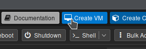
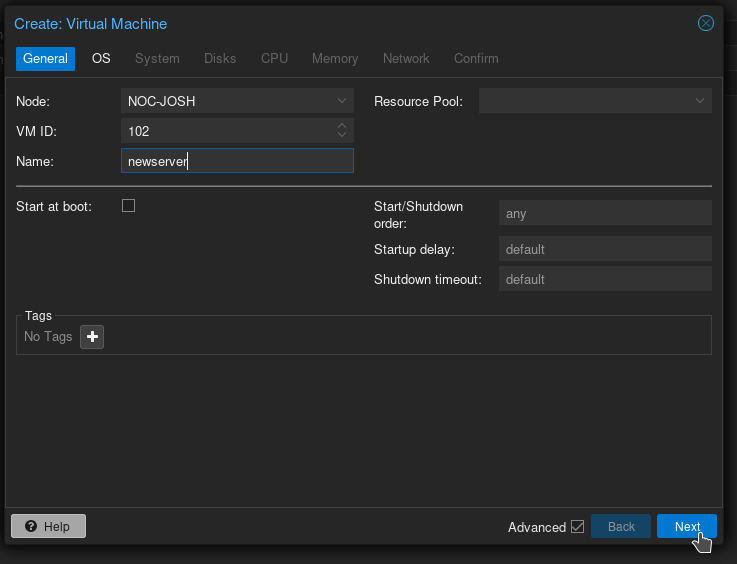
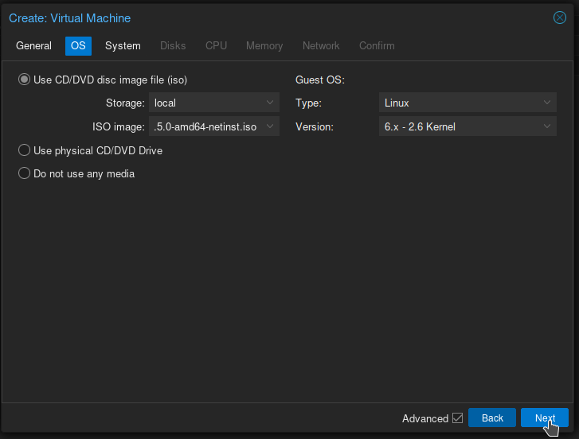
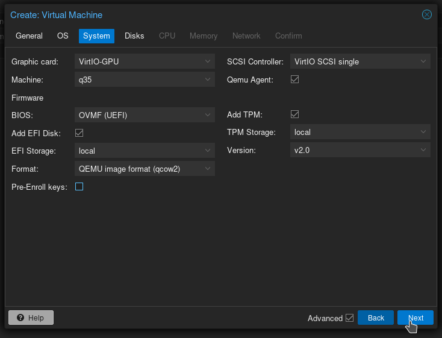
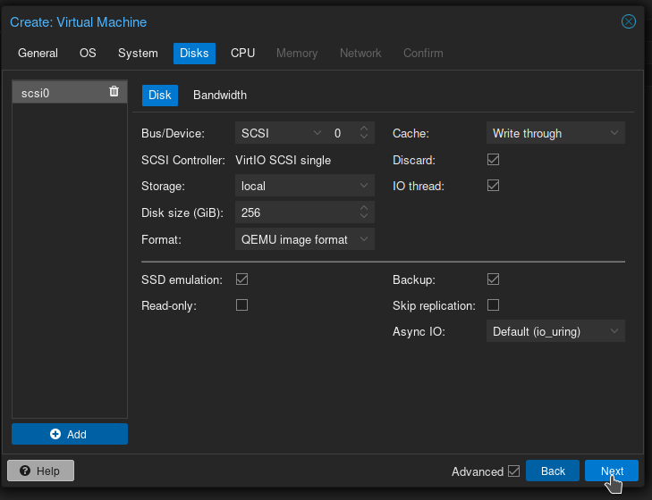
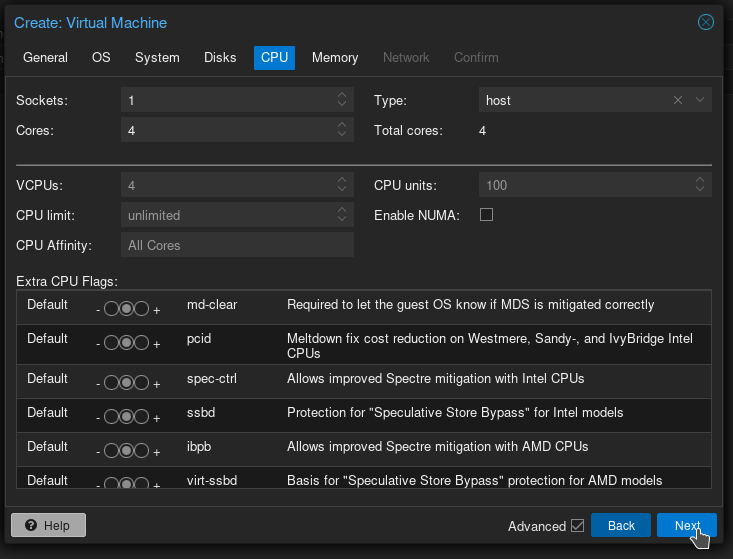
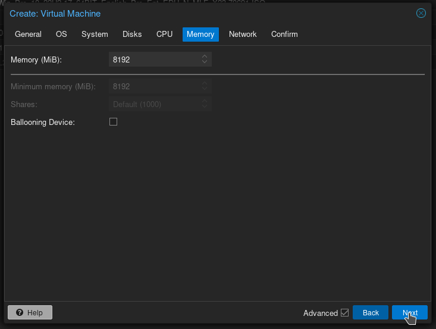
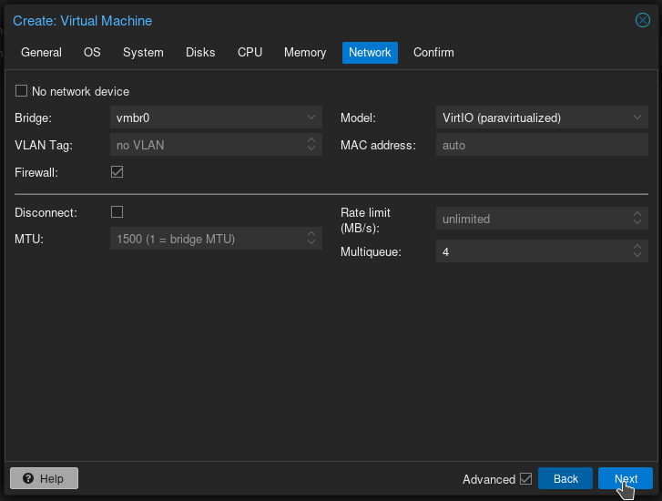
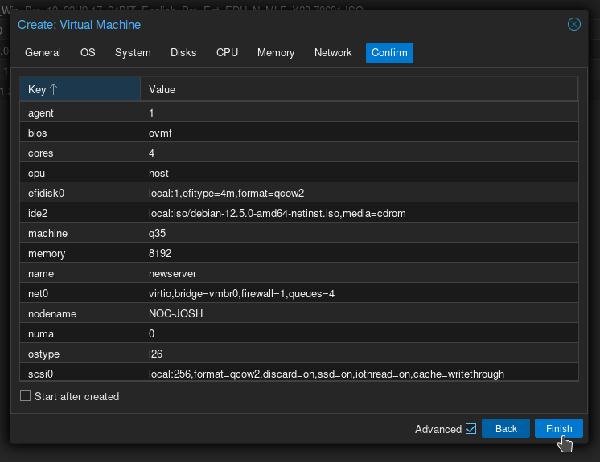

src: https://wcgw.ghost.io/ideal-proxmox-settings-for-a-linux-vm/

# Ideal Proxmox Settings for a Linux VM

I've done a lot of experimenting, and I have found a really great combination of settings for Proxmox to optimize the performance of Linux-based VMs. It's not as difficult as wrangling Windows VMs but there are a few potential pitfalls to avoid. Let's get started!

In Proxmox, let's click Create VM in the top-right.

Let's check the box near the bottom right marked **Advanced**, Enter a **Name**, and click **Next**. I like to make sure the name matches the future hostname of our VM, but they're easy to rename later on.

For **Storage**, choose the Storage location where you placed your ISO, and then choose your Linux ISO. Leave **Guest OS** as **Type: Linux** and **Version (latest)**. Click **Next**.

For **GPU**, we use **VirtIO-GPU** as it is highly performant, and allows us to use **SPICE**.
We leave **SCSI Controller** as-is (**VirtIO SCSI Single**)
Check the box for **Qemu Agent**. Having the QEMU agent on our VM gives us a bunch of cool features within Proxmox.
We change **BIOS** to **OVMF (UEFI)** as Legacy BIOS is largely deprecated at this point.
That means we have no choice but to add **EFI storage**. Choose the same storage location as you plan to keep the VM on.
Uncheck **Pre-Enroll Keys**, otherwise Secure Boot will be on & enforced, and your VM will likely not boot.
We'll check the box for **Add TPM** and change **Storage** to the same as our VM. We likely won't need this but it's better to have it now, and it doesn't hurt anything.
Click **Next**.

Now on to **Disks**, we have some choices to make here.
For Bus/Device, we want **SCSI** for performance reasons.
For **Cache**, [this table shows some really good info.](https://pve.proxmox.com/wiki/Performance_Tweaks?ref=wcgw.ghost.io#Disk_Cache) **Cache** can affect disk performance in a very significant way, and with better performance generally comes a risk of losing data in the event of a power outage. I prefer **Write through**; Read speeds are increased as Proxmox caches reads from the virtual drive, but writes are 100% safe as there is no write cache to disappear if the power goes out. You do take a bit of a performance hit on Writes but for our workloads it hasn't been noticeable and I'd rather be safe than sorry.
**Write back** is the best performing (excluding unsafe which should only be used in testing.) If your machine is on a proper UPS, has redundant PSUs, and you're really strapped for performance **Write back** can be a good option.
On to Format: A 256GB **QEMU image (QCOW2)** will only take up as much space on disk as is actually being used (which is less than 10GB after a fresh install.) a **RAW** disk will take up exactly as much space as we specify in Disk Size BUT has the added benefit of being faster, sometimes significantly so. If you have an abundance of storage, RAW is the way to go, otherwise I prefer QCOW2 if it's available.
If the **Storage** you are putting the virtual disk on is flash-based (so SSD, not HDD) you're going to want to check the box marked **Discard**, as well as **SSD Emulation**. This will allow the VM to know it's an SSD and to reclaim empty space when files are deleted.
Finally the Backup checkbox; If unchecked, this drive will not be kept when the VM is backed up, so make sure it's checked!
Click **Next**.

Next up, we have **CPU**.
The VAST majority of the time, you're going to want to set **Type** to **host**. This will yield maximum performance, and the only time it might cause issues is if you are trying to live-migrate a VM from one server to another with a different model of CPU.
For **Sockets**, if your machine supports **NUMA**, set this to the *same number of sockets as your machine* and check the **Enable NUMA** box. (As a general rule, if you have a multi-socket system, you can turn on NUMA in the BIOS) Otherwise set **Sockets** to **1**.
For **Cores**, set this acording to your workload. **4 Cores** total is a good starting point. Remember, this cannot be higher than the total number of cores your Proxmox server has.

For **Memory**, Choose an amount that seems appropriate (remember, 1GB = 1024MB)
With **Ballooning**, If you have plenty of RAM I would leave this unchecked, as you'll likely see a small performance boost. If you are at all memory constrained, check the box. For **Minimum memory**, In the event your Proxmox host's RAM starts to fill up, Proxmox will cut back the RAM available to each VM. Setting this minimum ensures that VM will never be cut back below that limit. It's an unlikely scenario unless your server is really stressed, so leaving **Minimum** the same as **Memory** is usually fine. Click Next.

On to **Network**, set your **VLAN** if needed.
Leave **Model** as **VirtIO**, and set **Multiqueue** to the *same as the number of cores in your virtual CPU*. This isn't well documented but it allows packets to be split into separate queues to be processed simultaneously and can speed things up. Click Next.

You did it!